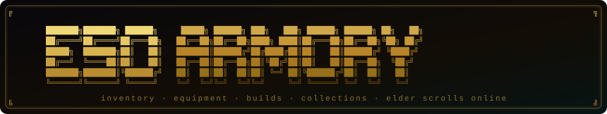

<div align="center">
  

**A web armory for your Elder Scrolls Online account.**

[](https://github.com/spanthetree/eso-armory/actions/workflows/tests.yml)

[](LICENSE)

[Getting started](#getting-started) ·
[Configuration](#configuration) ·
[Development](#development) ·
[Architecture](docs/architecture.md) ·
[Changelog](CHANGELOG.md) ·
[Contributing](CONTRIBUTING.md)

</div>

ESO has no way to see your account outside the game. Gear is spread across characters, banks, the craft bag and house chests, and builds live in addon menus. ESO Armory reads the data the [iasync](https://github.com/spanthetree/iasync) and [WizardsWardrobe](https://www.esoui.com/downloads/info3432-WizardsWardrobe.html) addons save, and shows every character's gear, builds, inventory, achievements and set collections in one browser page.

## Features

- **Characters.** Each character's equipped gear on an in-game style "Equipped" panel with the race silhouette, plus skill bars, Champion Points, attributes, max Health/Magicka/Stamina and Mundus Stone. Switch a character between Sheet, Wardrobe (saved WizardsWardrobe setups), Bags, Compare and SuperStar views.
- **Inventory.** Every item across characters, bank, ESO Plus bank, craft bag, house chests and guild banks. Search and filter by quality, type, trait, location and character, or group by set.
- **Build compare.** Export a build as a short code, import someone else's, and compare gear side by side. Missing pieces are listed with their source (dungeon, trial, arena) and an estimated Tamriel Trade Centre cost.
- **SuperStar import.** Upload a screenshot from the SuperStar addon and compare that build against your gear, slot by slot. Needs an Anthropic API key.
- **Achievements.** Account-wide progress by category, with achievement icons, per-character completions, criteria progress and recent unlocks.
- **Collections.** Set collection progress by category, with Tamriel Trade Centre prices on each piece.
- **Workspaces.** Each ESO account's data is stored once and reopens without re-uploading. Share a workspace with a pairing code, or load a second account beside your own.
- **Auto-sync.** In Chrome and Edge, point the app at your ESO folder once and it uploads changed files as you play.
- **Looks like the game.** Dark panels with gold rules, the game's own icons, animated loading and transitions, and a layout that fits one screen.

## How it works

1. iasync and WizardsWardrobe write `SavedVariables` files when you log out or `/reloadui`.
2. You upload those files in the browser, or the folder watcher uploads them for you.
3. The server parses the Lua, stores the processed result per ESO account in SQLite, and discards the raw file.
4. Open browsers refresh automatically when new data arrives.

## Getting started

### Requirements

- Docker with Compose, or Python 3.12+ and [uv](https://docs.astral.sh/uv/)
- Elder Scrolls Online with these addons:
  - [iasync](https://github.com/spanthetree/iasync) (required)
  - [WizardsWardrobe](https://www.esoui.com/downloads/info3432-WizardsWardrobe.html) (for saved builds)
  - [Tamriel Trade Centre](https://www.tamrieltradecentre.com/) (optional, for prices)

### Run with Docker

```bash
curl -O https://raw.githubusercontent.com/spanthetree/eso-armory/master/compose.yaml
docker compose up -d
```

This pulls `ghcr.io/spanthetree/eso-armory` and serves on port 5000. The first start downloads the game icons from UESP (about 2 minutes). Data lives in two volumes: `data` (accounts, config and its encryption key) and `assets` (icons).

- `ESO_ARMORY_PORT=8080` changes the port; `ESO_ARMORY_VERSION=0.2.0-beta.1` pins a release.
- Put `ANTHROPIC_API_KEY=...` in a `.env` file next to `compose.yaml` to enable SuperStar import.
- From a checkout, `docker compose up -d --build` runs your local code instead.
- To change [configuration](#configuration), copy it out with `docker compose cp web:/app/uploads/config.json .`, edit it, copy it back with `docker compose cp config.json web:/app/uploads/`, then `docker compose restart`.

### Run from source

Also needs [Node.js](https://nodejs.org/) 18 or newer to build the frontend.

```bash
uv sync
make ui-build                 # install frontend packages and build the app into static/dist
make assets                   # download game icons from UESP (about 2 minutes)
uv run server.py              # port 5000
uv run server.py --port 8080  # or another port
```

Open the server's address in a browser. The setup screen walks through the upload:

1. Log in to each character in ESO so iasync captures it. Open your bank once to capture bank contents.
2. Upload `iasync.lua` and `WizardsWardrobe.lua` from `Documents\Elder Scrolls Online\live\SavedVariables\`.

## Configuration

`config.json` is created on first run:

```json
{
  "ttc_addon_path": "path/to/AddOns/TamrielTradeCentre",
  "ttc_lookup_table_path": "path/to/AddOns/TamrielTradeCentre/ItemLookUpTable_EN.lua",
  "ttc_price_table_path": "",
  "database_url": "sqlite:///uploads/armory.db",
  "admin_accounts": [],
  "port": 5000,
  "server": "NA"
}
```

| Key | Meaning |
|---|---|
| `server` | Price region: `NA` or `EU` |
| `ttc_*` | Tamriel Trade Centre files for price lookups. Leave `ttc_price_table_path` empty to pick the table for `server`. Admin accounts can upload these files instead. |
| `database_url` | Where workspaces are stored |
| `port` | HTTP port |
| `admin_accounts` | ESO account names (e.g. `@name`) allowed to upload TTC files. An account only counts as admin after it sets a password. |

Set `ANTHROPIC_API_KEY` (or `anthropic_api_key` in `config.json`) to enable SuperStar import. Restart the server after changing the config.

The server speaks plain HTTP. Put it behind a reverse proxy such as Caddy or nginx for HTTPS.

## Development

```bash
uv sync --dev
make playwright-install  # once, for browser tests
make ui-dev              # frontend with hot reload on :5173; run the server on :5000 alongside
make test-fast           # Python unit + API tests
make frontend-test       # JavaScript unit tests
make test-ui             # builds the frontend, then Playwright in Chromium + Firefox
make test-all            # all of the above
```

The frontend is [Svelte 5](https://svelte.dev/) built with Vite, in `frontend/`. `make ui-build` writes it to `static/dist/`, which the server serves at `/`. Game data colours (item quality, resources) are fixed; everything else comes from the tokens in `frontend/src/lib/styles/tokens.css`.

How the server, storage and API fit together: [docs/architecture.md](docs/architecture.md).

Test fixtures in `tests/fixtures/` are sanitized. Do not commit live account data.

| Path | Purpose |
|---|---|
| `server.py` | FastAPI app, API, uploads, price lookups |
| `db.py` | SQLite workspace storage |
| `lua_parser.py` | SavedVariables Lua parser |
| `data_processor.py` | iasync and WizardsWardrobe data to API payloads |
| `item_link_decoder.py` | ESO item link decoder |
| `frontend/` | Svelte 5 frontend: `src/App.svelte` shell, `src/lib/` tabs, components and logic (unit-tested `*.test.js`) |
| `scripts/assets_manifest.json` | Game icon sources; `make assets` downloads them into `assets/` |

## Contributing

Bug reports, ideas and pull requests are welcome. See [CONTRIBUTING.md](CONTRIBUTING.md), and report security issues privately as described in [SECURITY.md](SECURITY.md).

## License

ESO Armory is source-available under the [PolyForm Noncommercial License 1.0.0](LICENSE): free to use, modify and share for any noncommercial purpose. Commercial use needs a separate license.

## Status

ESO Armory is in beta. Expect breaking changes between releases; the [changelog](CHANGELOG.md) lists them.

ESO Armory is not affiliated with, endorsed by or sponsored by ZeniMax Online Studios or Bethesda. The Elder Scrolls Online and its artwork are theirs. This repository contains no game artwork: `make assets` downloads icons from [UESP](https://en.uesp.net).
