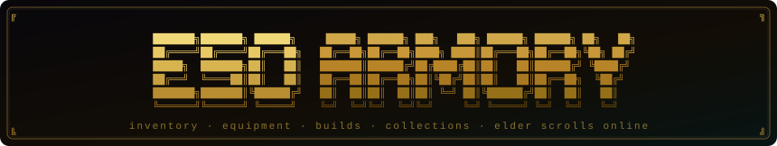

<div align="center">
  

**A web armory for your Elder Scrolls Online account.**

[](https://github.com/spanthetree/eso-armory/actions/workflows/tests.yml)
[](https://github.com/spanthetree/eso-armory/releases)
[](LICENSE)

[Getting started](#getting-started) ·
[Documentation](docs/README.md) ·
[FAQ](docs/faq.md) ·
[Changelog](CHANGELOG.md) ·
[Contributing](.github/CONTRIBUTING.md)

</div>

The Elder Scrolls Online has no way to look at your account outside the game.
Gear is spread across characters, banks, the craft bag and house chests, and
builds live in addon menus. ESO Armory reads the files that the
[iasync](https://github.com/spanthetree/iasync) and
[Wizard's Wardrobe](https://www.esoui.com/downloads/info3170-WizardsWardrobe.html)
addons save, and shows every character's gear, builds, inventory, achievements
and collections in one browser page.

## Features

- **Characters.** Equipped gear on the game's "Equipped" panel, skill bars,
  Champion stars, attributes, mundus, level, title, riding and guilds, with
  tooltips for items, sets, skills and stars.
- **Builds.** The in-game Armory's saved builds, with the one you are wearing
  marked; Wizard's Wardrobe setups; build codes to share and compare; and a
  [SuperStar](https://www.esoui.com/downloads/info3648-SuperStar-SeasonalUpdate.html)
  screenshot compared against your gear.
- **Inventory.** Every item across characters, banks, the craft bag, house
  chests and guild banks. Search, filter, group by set, find duplicates, and
  see [Tamriel Trade Centre](https://www.tamrieltradecentre.com/) values.
- **Crafting.** Trait research, motifs, recipes and scribing per character.
- **Journal and collections.** Achievements and Antiquities laid out like the
  in-game journal; the Collections book with set pieces, collectibles,
  housing, outfit styles and Tales of Tribute patrons.
- **Activities.** The Tamriel Tome, Endeavors, Golden Pursuits and every
  account currency.
- **Two looks.** *Classic* redraws the app in the game's own interface art;
  *Simple* is a plain dark web look.
- **Accounts.** Data is stored per ESO account and reopens without
  re-uploading. Protect it with a password, share a read-only view with a
  code, or load an alt account beside your own.
- **Auto-sync.** In Chrome and Edge the app watches your ESO folder and
  uploads new data as you play.

## Privacy

ESO Armory runs on your own machine or server. The SavedVariables files you
upload are parsed in memory; only the processed result is stored, and the raw
files are discarded. It never asks for your ESO password.

To draw the game's icons and tooltips, the server fetches public game data
from [UESP](https://en.uesp.net/), [eso-sets.com](https://eso-sets.com/) and
[eso-skillbook.com](https://eso-skillbook.com/). These requests carry only
icon, set or skill names, never your account data. SuperStar screenshots are
sent to OpenAI or Anthropic, and only when you use that feature with an API
key. See the [FAQ](docs/faq.md#privacy) for details.

## Getting started

You need [iasync](https://github.com/spanthetree/iasync) installed in ESO, and
Docker with Compose or Python 3.12 with [uv](https://docs.astral.sh/uv/).

1. **Start the server.**

   ```bash
   curl -O https://raw.githubusercontent.com/spanthetree/eso-armory/master/compose.yaml
   docker compose up -d
   ```

   The first start downloads the game icons, which takes about 2 minutes.
   To run from source instead, see [Installing](docs/install.md).
2. **Capture your characters.** Log in to each character once with iasync
   enabled, and open your bank. iasync writes its file when you log out or
   type `/reloadui`.
3. **Upload.** Open <http://localhost:5000>, choose **Select files**, and pick
   `iasync.lua` (and `WizardsWardrobe.lua`, if you use it) from
   `Documents\Elder Scrolls Online\live\SavedVariables\`. In Chrome or Edge,
   watch the folder instead to upload automatically.
4. **Set a password** when the app asks, so the account opens on other
   devices and nobody else can claim it.

Want to look first? **Open the demo account** on the landing page.

## Known limitations

- **One character at a time.** ESO only exposes the logged-in character, so
  each character appears once you have logged in to it with iasync.
- **Armory skill bars and Champion stars** appear after you visit an Armory
  station; the game provides them only there.
- **The equipped Armory build** is worked out by matching gear, attributes and
  mundus, because the game does not report which build is loaded.
- **Auto-sync** needs a Chromium browser. Elsewhere, upload the files by hand.
- **Plain HTTP.** Put the server behind a reverse proxy for HTTPS.

## Documentation

| Guide | Contents |
|---|---|
| [Installing](docs/install.md) | Docker, running from source, cloud hosting, upgrading |
| [Configuration](docs/configuration.md) | `config.json`, environment variables, HTTPS |
| [Using ESO Armory](docs/using.md) | Every tab and view, sharing, passwords, auto-sync |
| [FAQ](docs/faq.md) | Privacy, addon versions, troubleshooting |
| [Architecture](docs/architecture.md) | Data flow, API, storage and the security model |
| [Development](docs/development.md) | Project layout, the frontend, tests, icons, releases |

## Related projects

| Project | Role |
|---|---|
| [iasync](https://github.com/spanthetree/iasync) | The ESO addon that exports your account (required) |
| [Wizard's Wardrobe](https://www.esoui.com/downloads/info3170-WizardsWardrobe.html) | Saved gear and skill setups (optional) |
| [Tamriel Trade Centre](https://www.esoui.com/downloads/info1245-TamrielTradeCentre.html) | Price tables for item values (optional) |
| [SuperStar](https://www.esoui.com/downloads/info3648-SuperStar-SeasonalUpdate.html) | Build screenshots to compare (optional) |
| [UESP](https://en.uesp.net/) | Game icons and skill names |

## Development

```bash
uv sync --dev
make ui-build    # build the frontend (Node.js 18+)
make assets      # download game icons
make run         # http://localhost:5000
make test-all    # unit, API and browser tests
```

See [Development](docs/development.md) and
[Contributing](.github/CONTRIBUTING.md).

## License

ESO Armory is source-available under the
[PolyForm Noncommercial License 1.0.0](LICENSE): free to use, change and share
for any noncommercial purpose. Commercial use needs a separate license.

ESO Armory is in beta; the [changelog](CHANGELOG.md) lists breaking changes.
It is not affiliated with or endorsed by ZeniMax Online Studios or Bethesda.
The Elder Scrolls Online and its artwork belong to them. This repository
contains no game artwork: icons are downloaded from
[UESP](https://en.uesp.net/) when the server is set up.
